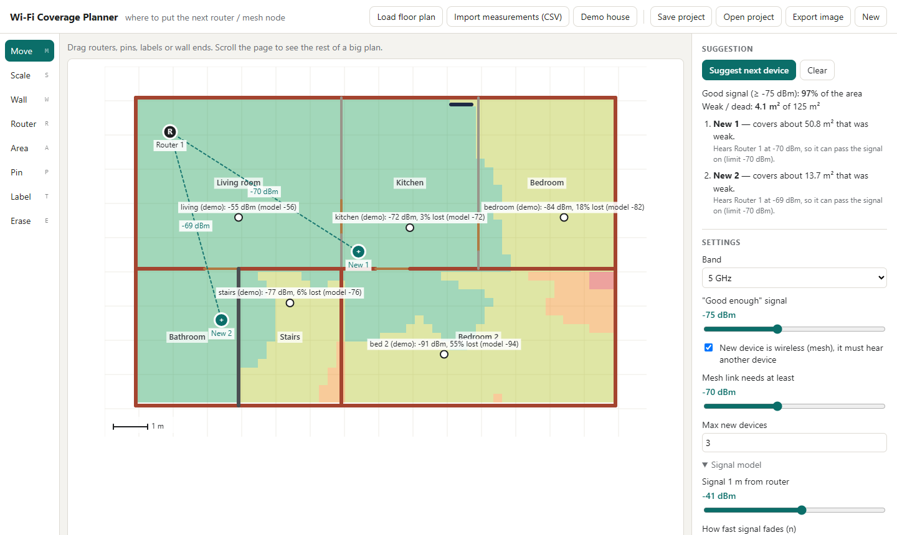

# Wi-Fi Coverage Planner

Where do I put the next router / mesh node?

Two small tools that work together:

1. **`measure/measure.py`** – walk around with a laptop, type the name of the spot you're standing at, and it records the Wi-Fi signal (dBm) and how many pings to the router get lost. Saves a CSV.
2. **`planner/index.html`** – load a floor plan, draw the walls, place your router. It estimates the signal everywhere, shows the dead zones, checks the estimate against your real measurements, and suggests where the next device should go.



*Demo house that opens by default. The measurement numbers in the demo are made up (marked "demo"), the walls and the logic are real.*

## Run it

Nothing to install. You need Python 3 (for measuring) and a browser.

**Measure** (Windows or Linux, laptop connected to Wi-Fi):

```bash
python measure/measure.py
```

What it prints (shortened; the last spot is an example of a weak one):

```
Spot name: living room
  measuring 'living room' for 10 s, stand still...
  -> living room: median -54 dBm, lost 0.0 %  =>  OK (good signal)
Spot name: basement door
  ...
SUMMARY (in the order you walked)
living room     -54 dBm  ###################...........  lost   0.0 %  OK
hallway         -63 dBm  ##############................  lost   0.0 %  OK
basement door   -77 dBm  ########......................  lost   6.0 %  PUT NEXT DEVICE HERE
Next device: at 'basement door' (or between 'hallway' and 'basement door').
```

Options: `--seconds 20` (longer per spot), `--target 192.168.1.1` (what to ping, default is your router), `--fake` (made-up numbers, to try it without walking around).

**Plan:** open `planner/index.html` in a browser (double-click is enough).

1. *Load floor plan*: a photo, a scan or a blue blueprint (PNG/JPG). You can also drag the picture onto the plan or paste a screenshot with Ctrl+V. A blueprint (white lines on blue) is noticed and shown as dark lines on white, so the coverage colours stay readable; *Settings › Floor plan image* switches between colour, black and white, blueprint, and fades the picture. A PDF plan: take a screenshot of it first. Or open one of the *Demos*: a house, an office floor drawn on a blue blueprint, or a small town covered by rooftop mesh nodes.
2. **Scale**: click two ends of something you know the length of, type metres.
3. **Wall**: draw the walls, pick the wall type (drywall, brick, concrete, metal...).
4. **Router**: click where your router is.
5. *Import measurements (CSV)* from step 1, then click on the plan where you stood for each one.
6. *Signal model → Match model to my measurements*.
7. **Suggest next device**.

*Save project* keeps everything (plan image included) in one `.json` file. Ctrl+Z undoes.

## How it works

**Signal estimate.** The usual simple indoor model (log-distance path loss):

```
signal (dBm) = signal at 1 m  −  10 · n · log10(distance in m)  −  loss of every wall in the way
```

`n` says how fast the signal fades: about 2 in open space, 3–4 in a house. The wall losses are rough typical values:

| Wall | 2.4 GHz | 5 GHz |
|---|---|---|
| Glass | 2 dB | 3 dB |
| Drywall | 3 dB | 5 dB |
| Wooden door | 4 dB | 6 dB |
| Brick | 8 dB | 12 dB |
| Concrete | 12 dB | 18 dB |
| Metal / fridge | 20 dB | 26 dB |

**Matching real measurements.** The model is only a guess, so the measured spots correct it: a least-squares fit finds the "signal at 1 m" and `n` that best explain what you actually measured. In the demo the average miss drops from 5.4 dB to 1.9 dB.

**Suggestion.** It tries every spot on a 1 m grid and picks the one that turns the most weak area into good area, then repeats (up to "Max new devices"). It stops when a new device would fix less than 5 % of the area, because then it's not worth a device.

**Mesh rule.** A wireless (mesh) node is only useful if it still hears another node well, otherwise it has nothing to pass on. So a spot is only allowed if the signal from an existing device there is at least the "mesh link" limit (default −70 dBm). That's why the suggestions end up at the edge of good coverage, usually at a door or a corner where the node "sees" both parts, and not in the middle of the dead zone.

### Why −75 dBm and 5 %

- Wi-Fi is solid down to about −70 dBm. Below about −80 dBm messages start getting lost.
- So I put the next device at about **−75 dBm, or when more than 5 % of pings get lost**, *before* the link breaks. The spare margin matters because the signal moves around (people walking by, doors, humidity in a basement or cave).
- The planner colours: green ≥ −65 (great), yellow ≥ −75 (good), orange −75 to −82 (edge, plan the next device), red below (dead zone). All limits are sliders.

## What doesn't work yet / limits

- **The model is rough.** No reflections, no furniture, one wall type per line. It's a starting point, the measurements are what count.
- **One floor only.** Basement and upstairs have to be separate plans; signal through a ceiling isn't modelled.
- **You pin the spots by hand.** The laptop doesn't know where it is.
- **Measuring works on Windows and Linux** (netsh / iw). No macOS. On older Windows that only shows signal in %, it converts % to dBm roughly.
- Windows refreshes the signal value only every few seconds, so stand still for the 10 s.
- Only Wi-Fi. I want to try the same "where does the next node go" idea with two ESP32 + LoRa boards (basement → tunnels), where the limit is much lower (around −120 dBm) and packet loss matters more.
- Tested on my own home network and the demo house, not yet in a big building or underground.

## Files

```
measure/measure.py     walk-and-measure script (Python standard library only)
planner/index.html     the planner (plain HTML + JS, no build, no internet needed)
planner/app.js         signal model, calibration, suggestion
examples/demo.js       demos: house, office floor on a blueprint, small town (all made up)
examples/fake-walk.csv sample CSV from measure.py --fake
```

Your own measurement files (`measurements-*.csv`) are ignored by git, because they contain your network name and router address.

## License

MIT
